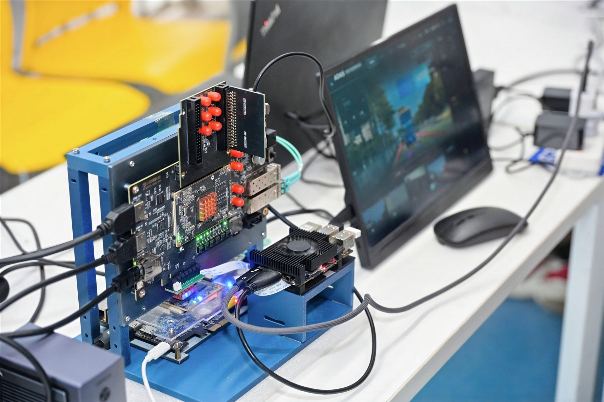

# Pango 双 FPGA 视频处理与车道感知

本项目是一套双 FPGA 视频处理与车道感知平台。**小眼睛科技 PG2L100H（盘古 100Pro+）** 汇集以太网、OV5640、HSST 光纤和 HDMI 四路视频，经 DDR3 缓存后输出 HDMI 环视画面，并通过 PCIe DMA 向 RK3566 Linux 主机提供采集画面。**正点原子 PG2L200H** 负责采集和车道推理，通过 HSST 光纤发回视频和推理结果。



*双 FPGA 视频系统联调台实拍，仅展示硬件布置，不作为当前提交的验收记录。*

[板卡与工程](#板卡与工程) · [Windows 以太网上位机](#windows-以太网上位机) · [系统数据流](#系统数据流) · [构建与依赖](#构建与依赖) · [联调与排查](#联调与排查) · [FPGA 资源使用量](#fpga-资源使用量) · [发布检查](#发布检查)

## 板卡与工程

| 开发板（厂商） | PDS 目标器件 | 打开工程 | 阅读顶层 |
| --- | --- | --- | --- |
| **小眼睛科技** 盘古 100Pro+（`MES2L676-100HP`） | `PG2L100H-6FBG676` | [PG2L100H_PRJ.pds](PG2L100H/PG2L100H_PRJ.pds) | [top_design.v](PG2L100H/source/top_design.v) |
| **正点原子（ALIENTEK）** PG2L200H | `PG2L200H-6FBB484` | [PG2L200H_PRJ.pds](PG2L200H/PG2L200H_PRJ.pds) | [host_hdmi_to_fiber_top.v](PG2L200H/host/rtl/host_hdmi_to_fiber_top.v) |

两份工程的参考环境均为 **PDS 2025.2 build 211867**，综合工具配置为 `ads`。两块板的引脚、时钟、外设初始化和生成 IP 不可混用，位流也不能互换。

## Windows 以太网上位机

**下载：[PG2L200H_V013_SerialSource.exe](https://github.com/CMCCNIKO/Pango_file/releases/download/windows-ethernet-host-v013/PG2L200H_V013_SerialSource.exe)** · [V013 发布说明](https://github.com/CMCCNIKO/Pango_file/releases/tag/windows-ethernet-host-v013)。下载需要有本私有仓库的访问权限。

V013 为 Windows 单文件程序，保留以太网视频发送、预览与 ISP 控制。`SerialSource` 指另带的 PG2L200H 串口切源功能，不表示视频走串口。

| 连接 | 用途 | 默认设置 |
| --- | --- | --- |
| Windows → 以太网 → **小眼睛科技 PG2L100H** | 向 `source0` 发送 PGV1 视频、发送控制命令并接收应答 | FPGA `192.168.1.11`，视频 UDP `5000`，控制 UDP `5002`；应答发往 Windows `192.168.1.105:5001` |
| Windows → USB 串口 → **正点原子 PG2L200H** | 切换该板 HDMI / OV5640 输入，需匹配的 FPGA 固件 | `COM6`、`115200`、`8N1`，按实际连接选择 COM 口；不依赖网口 |
| **PG2L100H** → PCIe DMA → **RK3566** | 从 FPGA 采集视频，不使用此 EXE | 使用[配套仓库的 Linux 驱动与采集程序](https://github.com/CMCCNIKO/PG2L100H-PCIe-RK3566/tree/main/PG2L100H_RX_ETW_HDMI_OV5640_HSST/host/pcie_video) |

使用 [FPGA 默认网络参数](PG2L100H/source/top_design.v#L42-L49) 时，Windows 有线网卡设为 `192.168.1.105/24`，上位机目标设为 `192.168.1.11`，分别核对视频发送和控制应答。本次仅同步上位机发布包，未重新对本仓库的位流做逐项实板联调。

- 文件大小：`293,441,701` 字节
- SHA-256：`C637912C530BA05B0292A185B5467AA64D333C44197E8314A59121A02DD04AB6`

## 系统数据流

```text
正点原子 PG2L200H
  HDMI (ADV7611) 或 OV5640
    +-- 640x320 RGB565 显示流
    +-- 224x168 图像 -> F14 推理与后处理 -> 车道元数据
  HSST/SFP TX：发送显示流与帧间元数据
    |
    v  光纤
小眼睛科技 PG2L100H
  HSST/SFP RX 视频 + 以太网 PGV1 + 本地 OV5640 + HDMI (MS7200)
    -> DDR3 四路帧缓存
       +-- 四宫格 -> 共享 ISP / 去雾 -> PCIe 视频采集
       +-- 监视路由 / 环视合成 -> HUD -> HDMI (MS7210)
  光纤元数据 -> 独立解析与跨时钟域同步 -> HUD / 状态逻辑
```

**HDMI 与 PCIe 的取图点不同。** PCIe 从共享去雾层取图；默认 HDMI 输出经过监视与环视（AVM）合成，再叠加抬头显示（HUD），合成器也可使用 HDMI 专用算法路径的画面。

## 正点原子 PG2L200H：采集与推理

1. **输入与切换**：ADV7611 接收 HDMI 并行像素，OV5640 通过 DVP 输入。两路在 **50 MHz 视频控制域**进行帧级选择，分别形成 `640×320` 显示流与 `224×168` CNN 输入流。
2. **F14 车道处理**：模型流水线负责推理，帧引擎与视频处理模块负责车道后处理、线型和斑马线相关判断、元数据收集以及 RGB565 叠线。
3. **光纤发送**：视频以 `HSST-VIDEO-V1` 封装，车道结果以 `LANE-META-V1` 在视频帧间发送。当前 [`host_mode_select.vh`](PG2L200H/host/rtl/fiber/host_mode_select.vh) 定义 `HOST_TX_MODE_HDMI`，选择实际视频发送分支；该分支仍可接收选源命令，不等于只支持 HDMI 输入。当前顶层没有本地 HDMI 输出。
4. **串口接收端**：[`host_av_uart_source_select.v`](PG2L200H/host/rtl/control/host_av_uart_source_select.v) 使用 `115200`、`8N1`；命令中的源编号 `0` 为 HDMI，`1` 为 OV5640。成功应答表示切换已应用，不只是命令已收到。此处命令编号与 PG2L100H 的四路帧缓存编号无关。

| 功能 | 从这里开始 |
| --- | --- |
| HDMI 与 OV5640 输入 | [host/rtl/monitor/](PG2L200H/host/rtl/monitor/)、[host/rtl/camera/](PG2L200H/host/rtl/camera/) |
| 推理流水线、车道结果与叠线 | [F14 推理核心](PG2L200H/model/rtl/f14_pipeline_core.v)、[车道处理总成](PG2L200H/host/rtl/video/host_f14_video_lane_path.v)、[lane/rtl/](PG2L200H/lane/rtl/) |
| 光纤协议与发送 | [协议头](PG2L200H/host/rtl/fiber/fiber_video_v1_defs.vh)、[视频封包](PG2L200H/host/rtl/fiber/fiber_video_tx_packetizer.v)、[元数据发送](PG2L200H/host/rtl/fiber/host_hsst_lane_meta_tx.v) |
| 板级约束 | [引脚约束](PG2L200H/host/constraints/host_pg2l200h_pins.fdc)、[时序约束](PG2L200H/host/constraints/host_pg2l200h_timing.fdc) |

## 小眼睛科技 PG2L100H：处理与显示

四路视频通过各自的输入与时钟域转换进入 DDR3。默认 Q8 路径为每路维护三个帧槽；四宫格链路可按源读出，缺源补黑。下表中的 AVM 视角是当前 LUT 配置中的角色，不代表板上接口的物理位置。

| 帧缓存编号 | 视频输入 | AVM 视角 | RTL 入口 |
| --- | --- | --- | --- |
| `source0` | 板载以太网，UDP/PGV1 RGB565 | 右 | [ethernet_top.v](PG2L100H/source/subsystems/ethernet_top.v) |
| `source1` | 本地 OV5640（CMOS1） | 后 | [ov5640_source1_word_cdc.v](PG2L100H/source/video/ov5640_source1_word_cdc.v) |
| `source2` | 正点原子 PG2L200H 发送的 HSST 光纤视频 | 前 | [fiber_video_rx_assembler.v](PG2L100H/source/fiber/fiber_video_rx_assembler.v) |
| `source3` | 本地 HDMI 输入（MS7200）；当前输入链将 `1920×1080` 裁剪/抽样为 `640×320` RGB565 | 左 | [video_sources_top.v](PG2L100H/source/subsystems/video_sources_top.v) |

| 子系统 | 作用与入口 |
| --- | --- |
| DDR3 与四宫格 | [frame_buffer_top.v](PG2L100H/source/subsystems/frame_buffer_top.v) 管理帧槽、读写仲裁与四宫格输出。当前顶层 `C_Q8_WRITE_BURST_BEATS=1`，保留单拍 DDR 写入兼容配置。 |
| ISP 与去雾 | [video_algorithm_top.v](PG2L100H/source/subsystems/video_algorithm_top.v) 处理逐画面 ISP、共享去雾和配置同步。高斯、灰度中值、Sobel 位于 HDMI 专用后级。 |
| AVM 与监视 | [avm_monitor_top.v](PG2L100H/source/subsystems/avm_monitor_top.v) 负责 LUT 装载、环视渲染和监视合成。默认 `C_LUT_SOURCE=2`，从 SD 启动加载。 |
| HDMI 输出 | [hdmi_board_top.v](PG2L100H/source/subsystems/hdmi_board_top.v) 管理 MS7200/MS7210 和 HUD，使用 `74.25 MHz` 的 720p60 输出像素时钟。默认 `C_HDMI_QUAD_OUTPUT=0`，显示监视合成；置 `1` 是原始四宫格诊断路径。 |
| PCIe x4 | [pcie_top.v](PG2L100H/source/subsystems/pcie_top.v) 从共享去雾层采集视频，由 [pcie/](PG2L100H/source/pcie/) 实现 DMA、视频与寄存器逻辑。主机侧联调还需匹配的驱动与应用。 |
| 光纤车道元数据 | [fiber_lane_meta_rx.v](PG2L100H/source/fiber/fiber_lane_meta_rx.v) 独立解析帧间元数据，不写入视频 FIFO，也不将样本强行绑定到同一编号的视频帧。 |

以太网顶层默认本机 IP 为 `192.168.1.11`，视频接收 UDP 端口为 `5000`，控制 UDP 端口为 `5002`。这些是工程参数，不是开发板的出厂配置。其他引脚与时序定义见 [PG2L100H 约束目录](PG2L100H/source/constraints/)。

## 构建与依赖

**从 GitHub 检出后不能直接完整构建。** 厂商 IP 生成文件、第三方参考 RTL 和部分板级原语暂不随仓库上传。`.pds` 仍保留原工程引用；构建前请根据 [本地厂商依赖](#本地厂商依赖) 补齐文件。

### 关键文件与外部依赖

| 用途 | 当前情况 |
| --- | --- |
| PG2L200H F14 模型 ROM | [rom_words32.hex](PG2L200H/assets/old_normalized/rom_words32.hex) 已随工程保存。保留它相对于 PG2L200H 工程目录的路径。 |
| PG2L100H ISP 色调 ROM | [tone_profiles.dat](PG2L100H/v025_isp_natural_tone/PG2L100H_final/assets/isp/tone_profiles.dat) 已随工程保存，但 [IP 配置](PG2L100H/ipcore/isp_tone_lut_2048x8/isp_tone_lut_2048x8.idf) 和生成的 Verilog 仍指向旧机器。换机后通过 PDS IP Compiler 重新关联数据并生成该 IP。 |
| PG2L100H 实板 AVM | 需另备与四路视角映射匹配的 SD 卡 LUT。[装载器](PG2L100H/source/avm/avm_lut_sd_loader.v) 从原始扇区 `LBA 16672` 读取 `9600` 个 512 字节块；它不按文件名读取，片内 ROM 的 `.dat` 也不能替代。 |
| PG2L100H PCIe 主机端 | 目录内是 FPGA 工程；验证主机取流还需匹配的驱动与应用，不把 FPGA 位流当作完整主机软件。 |

### PDS 构建顺序

1. 分别打开两个 `.pds`，确认器件、封装、顶层、头文件搜索路径及约束。按工程登记的清单编译，不要递归导入所有 Verilog，以免混入旧模块和 IP 示例。
2. 核对上表的 ROM 路径和 IP 依赖。若需重建厂商 IP，按各自目标器件重新生成，不从另一块板复制生成文件。
3. 运行 `Compile → Synthesize → Device Map → Place & Route → Report Timing`，检查约束覆盖、setup/hold 及未约束路径。再用 `Generate Bitstream` 生成对应板卡的位流，避免使用其他器件或历史构建的输出。

### 本地厂商依赖

- **小眼睛科技 PG2L100H**：`PG2L100H/ipcore/` 只提交 `.idf` 配置；需使用匹配的 PDS IP Compiler 恢复对应 IP 的生成文件，并从有授权的参考包补齐 `PG2L100H/source/pcie_ref/`。
- **正点原子 PG2L200H**：需从有授权的工程副本恢复 `PG2L200H/host/ipcore/`、`PG2L200H/model/ipcore/`、`PG2L200H/vendor/`，以及 `.gitignore` 单列的 HDMI 与 OV5640 参考 RTL。
- 保留原目录结构，并对照各自 `.pds` 核对文件名、器件、IP 接口和约束。仓库不包含用于替代这些依赖的空壳模块。

**验证范围**：上传前核对的是本机完整工程的文件路径与 GitHub 提交范围。未重新运行 PDS 构建、功能仿真、布局布线后延时仿真、STA 或实板测试。历史 `prj_tasks/`、报告和位流不能代替重新验证。

## 联调与排查

建议先在 **小眼睛科技 PG2L100H** 上验证一条本地视频源和 HDMI 输出，再接入 **正点原子 PG2L200H** 的光纤视频。确认视频组帧和车道元数据接收后，再检查 AVM、HUD 与 PCIe 各自的输出。接线以本板原理图、PCB 修订和工程约束为准。

| 现象或步骤 | 优先检查 |
| --- | --- |
| 光纤无画面 | 确认**正点原子 PG2L200H 的 TX**接到**小眼睛科技 PG2L100H 的 RX**，再按各板约束核对 SFP 口与参考时钟。PG2L100H 的 `i_sfp0_*`、`fiber_hsst_ch0` 是历史命名；[板级约束](PG2L100H/source/constraints/ethernet_hdmi_pg2l100h.fdc) 标注实际接收为 SFP1（板端信号名 `SFP2`）、HSST Channel 2，不要按 `sfp0` 信号名猜接口。 |
| UART 选源没有应答 | PG2L200H 保留串口选源服务，但当前 PG2L100H 顶层没有接入选源发送逻辑，`o_uart_tx` 固定为高电平。仅连接两板不会自动发送选源命令；测试选源需要匹配电平和协议的独立控制端。 |
| 本地画面正常，其他源缺画面 | 按 PG2L100H 四路输入表核对 `source0` 至 `source3`。网口源需要 PGV1 数据，不是任意 UDP 视频；光纤源可分开查 HSST 链路、视频组帧和元数据解析。 |
| HDMI 有输出，但没有环视 | 先区分当前输出是默认监视合成还是四宫格诊断，再确认 DDR3 初始化和 SD 卡 LUT 装载状态；不要用 PCIe 画面判断 AVM/HUD 是否工作。 |

## FPGA 资源使用量

下表只列 **最终布局布线及路由优化后** 的数据，来源为各自的历史实现日志，使用 PDS `2025.2`（build `211867`）。LUT、FF 合计按 CLMA 和 CLMS 的已用量及可用量求和，百分比重新计算；其他百分比保留 PDS 报表的整数值。`DRM(grid)` 指物理块占用，不能与其他版本工具按逻辑块统计的 DRM 值直接换算。

### 小眼睛科技 PG2L100H

盘古 100Pro+（`MES2L676-100HP`），`PG2L100H-6FBG676`，顶层 `top_design`。来源：**2026-11-16 V030**（ISP / 去雾连续性）[最终路由优化日志摘录](docs/evidence/post-route-utilization.md#pg2l100h-v030)。这不是配套 `PG2L100H-PCIe-RK3566` 仓库的 PDS 2022.2 版实现。

| 资源 | 已用 / 器件可用 | 占用率 |
| --- | ---: | ---: |
| LUT（CLMA + CLMS） | 60,477 / 66,600 | 90.81%（计算值） |
| FF（CLMA + CLMS） | 82,381 / 133,200 | 61.85%（计算值） |
| CLMA | 11,586 / 11,675 | 100% |
| CLMS | 4,937 / 4,975 | 100% |
| DRM（物理块） | 144 / 155 | 93% |
| APM | 40 / 240 | 17% |
| I/O | 180 / 300 | 60% |
| DDR_PHY | 7 / 24 | 30% |
| PCIe 硬核 | 1 / 1 | 100% |
| HSSTLP lane | 5 / 8 | 63% |
| GPLL | 3 / 6 | 50% |
| PPLL | 2 / 6 | 34% |
| BKCL | 6 / 6 | 100% |

CLMA、CLMS 的 `100%` 为 PDS 报表的整数显示，以已用和可用计数为准。扩展逻辑或片上缓存前，应重新核对这两类逻辑块和 DRM 余量。

### 正点原子 PG2L200H

`PG2L200H-6FBB484`，顶层 `host_hdmi_to_fiber_top`。来源：**2026-11-15 V011**（无本地 HDMI 输出）[最终路由优化日志摘录](docs/evidence/post-route-utilization.md#pg2l200h-v011)。

| 资源 | 已用 / 器件可用 | 占用率 |
| --- | ---: | ---: |
| LUT（CLMA + CLMS） | 62,221 / 159,800 | 38.94%（计算值） |
| FF（CLMA + CLMS） | 65,056 / 319,600 | 20.36%（计算值） |
| CLMA | 15,064 / 30,075 | 51% |
| CLMS | 4,202 / 9,875 | 43% |
| DRM（物理块） | 386 / 415 | 94% |
| APM | 350 / 740 | 48% |
| I/O | 52 / 285 | 19% |
| HSSTLP lane | 1 / 4 | 25% |
| GPLL | 1 / 10 | 10% |
| BKCL | 4 / 10 | 40% |
